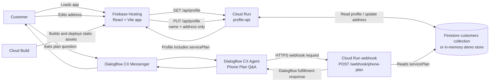

# gcp-serverless

React web app for a Telecom Mobile Phone Service Plan customer to view their profile and update their address. The service plan is loaded from the backend and shown read-only. The embedded Dialogflow CX Messenger answers questions about that plan through a Cloud Run webhook.

## End-to-end flow



`api/server.js` serves both the profile API and the Dialogflow CX webhook on the `profile-api` Cloud Run service. Firebase Hosting rewrites `/api/**` to that service. Configure the Dialogflow CX webhook URL as `https://<cloud-run-service-url>/webhook/phone-plan` and associate it with the agent's phone-plan question flow.

The current example uses one server-configured `CUSTOMER_ID`. It does not implement customer authentication or multi-customer identity resolution. For real customer data, derive the customer ID from a verified identity/session on the backend; do not trust an ID supplied by browser code or an unverified Dialogflow parameter. Restrict Cloud Run invocation and grant the Dialogflow caller only the access it needs.

## Data model and API

Firestore mode reads customer documents from `CUSTOMER_COLLECTION` (default `customers`), using `CUSTOMER_ID` as the document ID. A document must contain `name`, `address`, and `servicePlan`:

```json
{
	"name": "Taylor Morgan",
	"address": "100 Main Street",
	"servicePlan": "Unlimited 5G Plan"
}
```

| Endpoint | Purpose |
| --- | --- |
| `GET /api/profile` | Returns the customer name, address, and service plan |
| `PUT /api/profile` | Updates name/address only; service plan is never accepted from the form |
| `POST /webhook/phone-plan` | Returns the service plan in a Dialogflow CX webhook response |

Set `DATA_STORE=firestore` in Cloud Run to use Firestore. The Cloud Run runtime service account needs Firestore data access (for example, `roles/datastore.user`) and Application Default Credentials. The default `DATA_STORE=memory` is for local/demo use only; it does not persist across restarts or instances. Local demo values can be supplied with `CUSTOMER_NAME`, `CUSTOMER_ADDRESS`, and `SERVICE_PLAN`.

## Run locally

In one terminal:

```sh
cd api
npm install
DATA_STORE=memory npm start
```

In another terminal, from the repository root:

```sh
npm install
npm run dev
```

Vite proxies `/api` to `http://localhost:8080`. The Messenger uses the Dialogflow CX agent configured in `src/MessengerCode.jsx`; its remote webhook must be configured separately in the Dialogflow CX console.

## Deploy to GCP

1. Enable Firebase Hosting, Cloud Run, Cloud Build, and Firestore APIs in the project. Create/populate the customer document and configure a runtime service account with least-privilege Firestore access.
2. Deploy the API and webhook service:

	 ```sh
	 gcloud run deploy profile-api \
		 --source api \
		 --region us-central1 \
		 --set-env-vars DATA_STORE=firestore,CUSTOMER_ID=<customer-document-id>,CUSTOMER_COLLECTION=customers
	 ```

	 Configure invocation permissions for Firebase Hosting and Dialogflow CX according to the chosen authentication setup. Do not expose customer records publicly in a production deployment.
3. Configure the Dialogflow CX webhook to call the deployed service URL plus `/webhook/phone-plan`.
4. Set the Firebase project in `.firebaserc`, then build and deploy Hosting:

	 ```sh
	 npm run build
	 firebase deploy --only hosting
	 ```

`firebase.json` routes `/api/**` to the Cloud Run service `profile-api` in `us-central1` and sends other paths to the React app. The checked-in `cloudbuild.yaml` builds and deploys the static frontend when invoked by its configured Cloud Build trigger. Keep secrets out of `VITE_*` variables; those values are included in browser assets.

## Project layout

- `src/`: React profile form, read-only service plan display, and Dialogflow Messenger embed.
- `api/server.js`: Cloud Run profile API and Dialogflow CX webhook; supports memory and Firestore stores.
- `api/addressUpdate.js`: separate legacy customer lookup/update function; it is not the handler used by the current Firebase Hosting rewrite.
- `firebase.json`: Hosting configuration, API rewrite, and response security headers.
- `cloudbuild.yaml`: frontend build and Firebase Hosting deployment steps.
